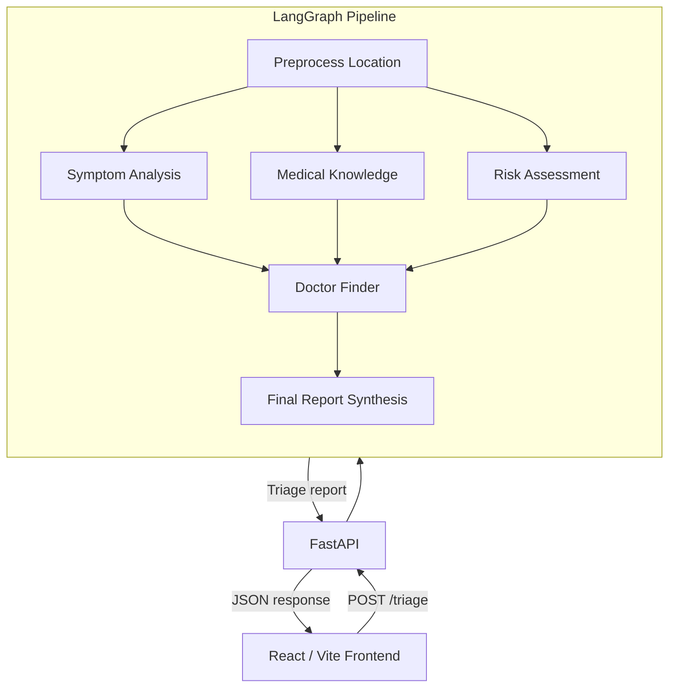
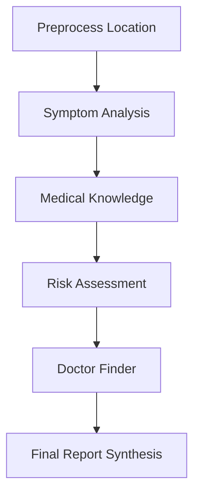

# MediTriage

MediTriage is an AI-powered medical symptom triage application. It turns a user's symptom description into a structured report with possible conditions, an urgency level, recommended next steps, and nearby care options.

> **Medical disclaimer:** MediTriage is an educational decision-support tool, not a diagnosis or a substitute for professional medical advice. For severe or life-threatening symptoms, contact local emergency services immediately.

## Features

- React and Vite frontend with symptom intake, triage results, report history, and PDF report generation.
- FastAPI backend exposing a simple triage API.
- LangGraph pipeline that coordinates specialized agents:
  - **Symptom Analyzer** — extracts symptoms, duration, severity, location, and red flags using a ReAct-style prompt.
  - **Medical Knowledge** — retrieves relevant context from Pinecone and generates possible conditions using RAG.
  - **Risk Assessor** — estimates urgency as `MILD`, `MODERATE`, `URGENT`, or `EMERGENCY`.
  - **Doctor Finder** — searches for nearby care options with Tavily, with an LLM fallback.
  - **Orchestrator** — combines the agent outputs into the final report.
- Optional IP-based location fallback using IP-API when the user does not provide a city or country.
- Optional n8n webhook mode for routing triage requests through an external workflow.


## Architecture




I showed the three analysis nodes as parallel branches that merge into the doctor finder. If they actually run sequentially, use this inside the subgraph instead:



GitHub renders Mermaid blocks natively in README files, so paste either one as is.

## Requirements

- Python 3.10+
- Node.js 18+
- A [Groq API key](https://console.groq.com/)
- Optional:
  - [Pinecone](https://www.pinecone.io/) for the retrieval-augmented medical knowledge base
  - [Tavily](https://tavily.com/) for nearby hospital and clinic search
  - n8n, if using webhook mode

## Quick start

Clone the repository and enter the project:

```bash
git clone https://github.com/faizan-siddique193/MediTriage.git
cd MediTriage
```

### 1. Configure the backend

Create `backend/.env`:

```dotenv
GROQ_API_KEY=your_groq_api_key

# Optional RAG configuration
PINECONE_API_KEY=your_pinecone_api_key
PINECONE_INDEX_NAME=meditriage-index

# Optional nearby-care search
TAVILY_API_KEY=your_tavily_api_key
```

Install the Python dependencies and start the API:

```bash
cd backend
python -m venv .venv

# macOS/Linux
source .venv/bin/activate

# Windows PowerShell
# .venv\Scripts\Activate.ps1

pip install -r requirements.txt
python main.py
```

The backend runs at `http://127.0.0.1:8000`.

### 2. Configure and start the frontend

In a second terminal:

```bash
cd frontend
npm install
cp .env.example .env
npm run dev
```

Open `http://localhost:5173`.

For local development, the Vite configuration proxies `/api` requests to the FastAPI server. To use a separately deployed API, set the following in `frontend/.env`:

```dotenv
VITE_PYTHON_API_URL=https://your-api.example.com
```

## Optional Pinecone knowledge base

The repository includes source data under `backend/knowledge_base/data`. To ingest it into Pinecone:

1. Create a Pinecone index with dimension `384` and cosine distance.
2. Set `PINECONE_API_KEY` and `PINECONE_INDEX_NAME` in `backend/.env`.
3. Run:

```bash
cd backend
python -m scripts.ingest_pinecone
```

The application uses the `all-MiniLM-L6-v2` embedding model and queries the top three matching records.

## API

### `GET /health`

Returns a service health response:

```json
{
  "status": "ok"
}
```

### `GET /agents`

Returns the configured agents and their design patterns.

### `POST /triage`

Request:

```json
{
  "symptoms": "I have had a sore throat and fever for two days",
  "city": "Lahore",
  "country": "Pakistan"
}
```

`symptoms` is required and must contain 1–8000 characters. `city` and `country` are optional; when location data is incomplete, the backend can attempt IP-based geolocation.

The response includes:

- `primary_disease`
- `detected_diseases`
- `urgency`
- `summary`
- `what_to_do`
- `symptom_analysis`
- `risk_assessment`
- `doctor_suggestions`
- `location_string`
- intermediate `agent_outputs`

## Frontend commands

Run these from `frontend`:

```bash
npm run dev       # Start the Vite development server
npm run build     # Create a production build
npm run preview   # Preview the production build
npm run lint      # Run ESLint
```

## n8n mode

The frontend can send triage requests to an n8n webhook instead of the FastAPI endpoint:

```dotenv
VITE_USE_N8N=true
VITE_N8N_WEBHOOK_URL=https://your-n8n-host/webhook/your-path
```

Leave `VITE_USE_N8N` unset or set it to `false` to use the FastAPI pipeline.

## Project structure

```text
MediTriage/
├── backend/
│   ├── agents/              # Symptom, knowledge, risk, doctor, and report agents
│   ├── core/                # Shared backend utilities such as geolocation
│   ├── knowledge_base/      # Source data and Pinecone ingestion tools
│   ├── langgraph_pipeline.py
│   ├── main.py              # FastAPI application
│   ├── models.py            # Request, state, and response schemas
│   └── requirements.txt
└── frontend/
    ├── src/
    │   ├── components/      # UI components
    │   ├── pages/           # Application routes
    │   ├── store/            # Client-side triage state
    │   └── utils/            # Parsing, persistence, and report helpers
    ├── package.json
    └── vite.config.js
```

## License

No license has been specified for this repository yet.
